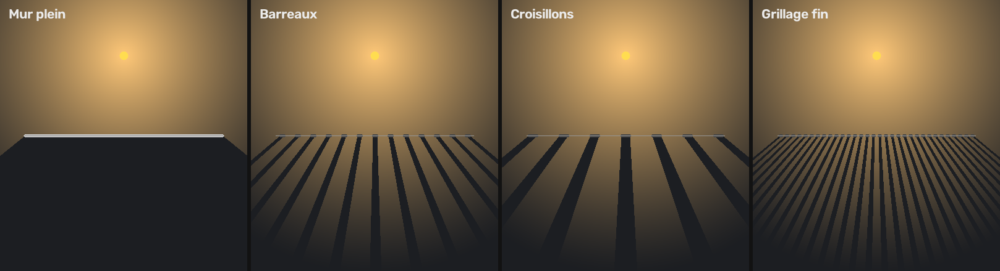

# Palisade

**Foundry VTT v14** : des murs qui restent reliés.

Une palissade, ce sont des pieux plantés côte à côte et liés entre eux. Palisade fait la même chose avec les murs de Foundry : les extrémités s'accrochent pendant le tracé, un mur posé au milieu d'un autre le coupe proprement en T, et quand tu déplaces un mur, ceux qui le touchaient suivent au lieu de laisser des trous par où la vision passe.

Un module de l'atelier [Quill & Seal](https://github.com/quill-and-seal).

> **État : 2.0.** Accroche, coupure en T, jointures qui suivent, pinceau qui colle les murs au dessin de la carte, et murs à motif lumineux. La suite est dans [ROADMAP.md](ROADMAP.md).

## Installation

Dans Foundry, **Modules complémentaires → Installer un module**, puis colle ce lien de manifeste :

```
https://github.com/quill-and-seal/Palisade/releases/latest/download/module.json
```

Active ensuite le module dans ton monde. Il n'a aucune dépendance.

## Ce que fait Palisade

Tout se passe dans l'outil des murs, sans rien changer à ta façon de tracer.

| Situation | Sans Palisade | Avec Palisade |
|---|---|---|
| Tu finis un mur près de l'extrémité d'un autre | Un petit écart reste, la lumière passe | L'extrémité se colle à l'autre |
| Tu finis un mur contre le milieu d'un autre | Les deux murs se croisent sans être reliés | L'extrémité se colle au mur, qui est coupé en deux à cet endroit |
| Tu déplaces l'extrémité d'un mur | Les murs voisins restent sur place | Les murs qui partageaient ce point le suivent |
| Tu déplaces un mur entier ou une sélection | Les jonctions avec le reste s'ouvrent | Les murs reliés s'étirent pour garder les jonctions |

Le bouton **chaîne** dans les outils des murs coupe ou réactive Palisade. Pratique pour poser un mur volontairement détaché.

Le raccourci **Maj + L** sélectionne tous les murs reliés au mur survolé, par exemple pour déplacer une pièce entière d'un coup. Il se change dans **Configurer les contrôles**.

## Pinceau

L'outil **pinceau** (icône pinceau, dans les outils des murs) pose les murs en suivant le dessin de la carte :

1. Dessine à main levée le long d'un ou plusieurs murs du fond de scène, sans viser précisément.
2. Relâche : le trait se colle aux murs dessinés et prend les angles avec eux. L'aperçu ambre montre les murs qui vont être créés (en rouge si aucun mur net n'a été trouvé : le trait est alors gardé tel quel).
3. **Clique** pour valider : le cadran s'ouvre à l'endroit du clic. Règle la précision et le type de mur, puis **Appliquer** crée les murs (**Annuler** les abandonne). Entrée et Échap font la même chose au clavier. Un nouveau trait remplace l'aperçu.

À la création, les points du trait se soudent aux points et aux murs déjà posés (distance d'accroche, 12 px à l'écran), et les passages qui repassent sur un mur existant ne sont pas recréés : pas de murs superposés.

Le **cadran** s'ouvre à l'endroit où tu cliques pour valider, bouton central sous le curseur :

- le **bouton central** règle la précision (molette, glisser vers le haut ou le bas, ou flèches du clavier) ; la graduation à gauche suit la valeur, et l'aperçu en attente se recalcule aussitôt ;
- les **segments de droite** choisissent le type de mur créé (clic sur le segment ou sur son nom) :

| Type | Personnages | Vue et lumière |
|---|---|---|
| Normal | Bloqués | Bloquées |
| Traversable | Passent | Bloquées |
| Invisible | Bloqués | Passent |
| Terrain | Bloqués | Limitées |
| Grille | Bloqués | Vue libre, lumière en bandes (motif barreaux) |

Le pinceau reconnaît seul les murs dessinés (traits sombres, murs de pierre) et les bords de matière, et cherche jusqu'à 48 px à l'écran autour du trait (réglable). Zoomer rend la recherche plus fine. Les murs créés s'accrochent aux murs voisins comme les autres.

Limites : le pinceau lit l'image de fond de la scène, pas les tuiles. Si les joints du sol (parquet, dallage) sont aussi marqués que les murs et plus proches du trait, il peut les suivre : dessine alors sur le mur lui-même. Le banc d'essai `tools/brush-lab.html` permet de tester le pinceau sur une carte hors de Foundry.

## Murs à motif lumineux

Un mur peut porter un **motif** : barreaux, croisillons ou grillage fin. Il bloque toujours le passage, mais la lumière passe entre ses barreaux et projette des **ombres en bandes** de l'autre côté, comme le soleil à travers une herse.



- **Clic droit sur un mur** (calque des murs) : le cadran s'ouvre à l'endroit du clic. Les segments choisissent le motif (*Aucun* le retire), le bouton central l'écartement (×0,5 à ×4, à la molette), puis **Appliquer** (ou Entrée). Si le mur cliqué fait partie de la sélection, le motif s'applique à tous les murs sélectionnés. Glisser au bouton droit déplace toujours la vue.
- **Dans la fiche du mur** (double-clic) : section **Palisade : motif lumineux**, mêmes réglages.
- **Au pinceau** : choisis le type **Grille** dans le cadran avant d'appliquer.

Le mur reste un seul mur : tu le déplaces, le modifies et le supprimes d'un bloc. Ses barreaux sont de petits murs cachés qui ne bloquent que la lumière ; ils sont recréés à chaque changement et supprimés avec lui. La vue n'est pas découpée : on voit à travers la grille. Les tailles suivent la case de la scène (barreaux tous les quarts de case).

| Motif | Écart | Épaisseur |
|---|---|---|
| Barreaux, herse | ¼ de case | 7 % de case |
| Croisillons | ½ case | 14 % de case |
| Grillage fin | 1/10 de case | 3,5 % de case (2 px minimum) |

## Réglages

| Réglage | Par défaut | Rôle |
|---|---|---|
| Murs auto-reliés | Activé | Interrupteur général, propre à ce navigateur (le même que le bouton chaîne) |
| Distance d'accroche | 12 px | Rayon, à l'écran, dans lequel une extrémité se colle à un autre mur (sert aussi à souder les murs du pinceau). 0 désactive l'accroche |
| Jointures qui suivent | Activé | Les murs voisins suivent un point déplacé |
| Coupure en T | Activé | Un mur touché en son milieu est coupé en deux |
| Ne jamais couper les portes | Activé | Une porte touchée en son milieu reste entière |
| Pinceau : distance de recherche | 48 px | Jusqu'où le pinceau cherche un mur autour du trait, à l'écran. Propre à ce navigateur |
| Pinceau : type de mur | Normal | Type des murs créés par le pinceau (aussi dans le cadran du pinceau). Propre à ce navigateur |
| Pinceau : précision | 2 px | Écart maximal entre les murs créés et le contour suivi, à l'écran. Plus bas : plus de détails. Propre à ce navigateur |

## API

```js
const palisade = game.modules.get("palisade").api;
palisade.enabled;                 // la liaison est-elle active pour ce client
palisade.connected(wall);         // Set des ids des murs reliés à ce mur
palisade.selectConnected(wall);   // les sélectionne sur le canevas
palisade.snapStroke(stroke, image, options); // colle un trait sur les murs d'une image
palisade.geometry;                // fonctions de géométrie (accroche, coupure, jointures)
```

Les modifications faites par Palisade portent l'option `{ palisade: true }`, pour que d'autres modules puissent les reconnaître.

## Développement

La géométrie (`scripts/geometry.js`), le pinceau (`scripts/brush.js`) et les motifs (`scripts/pattern.js`) ne dépendent pas de Foundry et se testent avec Node :

```
node --test tests/*.test.mjs
```

Le banc d'essai du pinceau se reconstruit avec `node tools/build-brush-lab.mjs`.

Une release GitHub publiée déclenche le workflow qui construit `module.json` et `module.zip` à partir du tag (`v0.1.0` → version `0.1.0`).
